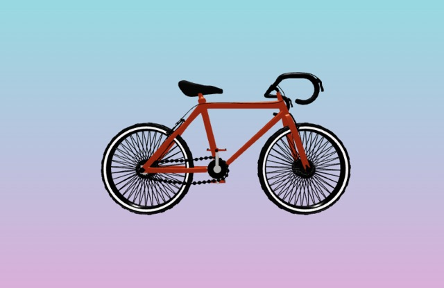
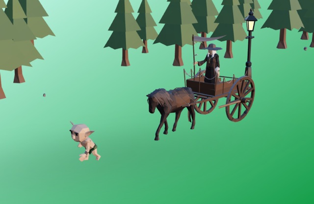
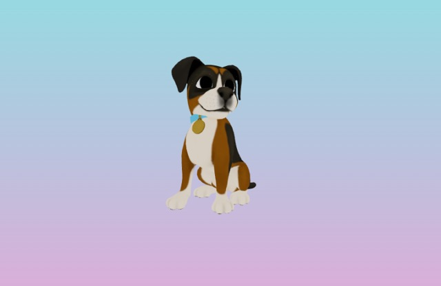
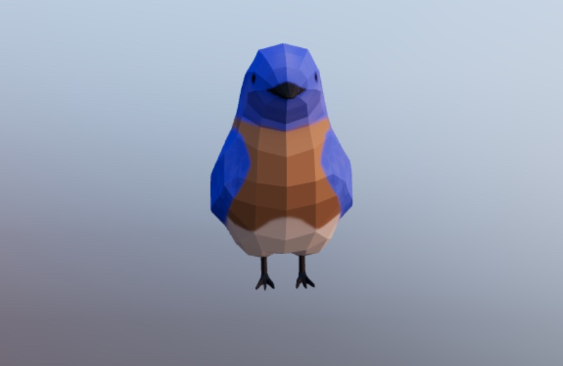
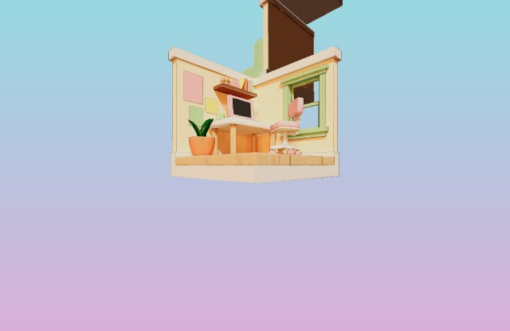
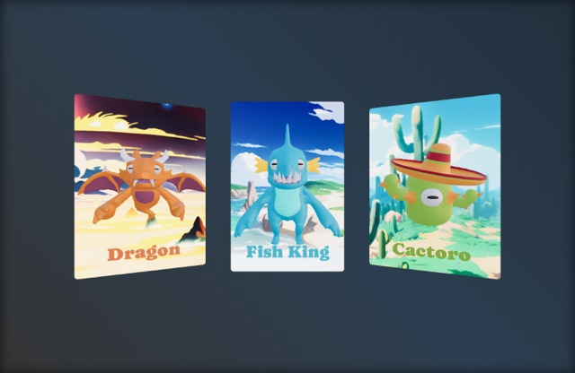
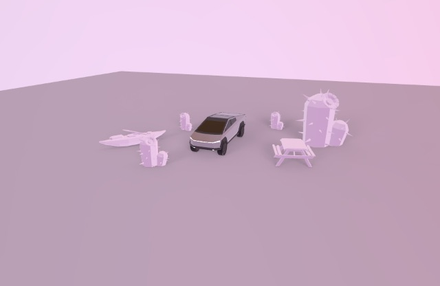
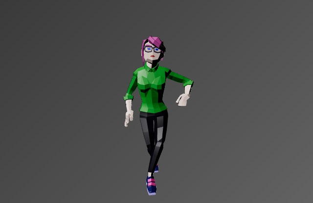

# ✨ 3D React Fiber Gallery ✨

Welcome to my **3D React Three Fiber Playground** project! 🚀  
This repository is an interactive workspace where you can explore 3D graphics experiments on the web using **React Three Fiber**. It's my first step in creating dynamic 3D experiences, enriched with numerous interactive elements.

It starts with a loader that transports you into a 3D scene, where you will explore models and looping animations, all designed to dynamically respond to user input and create a unique and engaging experience.

---

**🔗 Live demo: https://182marco.github.io/3D-React-Fiber-Gallery/**

Every scene has a shareable deep link (e.g. `#/dog`). Use the gallery button (top left) to switch between scenes.

<table>
<tr>
<td align="center"><a href="https://182marco.github.io/3D-React-Fiber-Gallery/#/bike"><br>Bicycle</a></td>
<td align="center"><a href="https://182marco.github.io/3D-React-Fiber-Gallery/#/cartfollowingmidget"><br>The Carriage of Destiny</a></td>
<td align="center"><a href="https://182marco.github.io/3D-React-Fiber-Gallery/#/dog"><br>Dog</a></td>
<td align="center"><a href="https://182marco.github.io/3D-React-Fiber-Gallery/#/explode"><br>Explode</a></td>
</tr>
<tr>
<td align="center"><a href="https://182marco.github.io/3D-React-Fiber-Gallery/#/home3d"><br>Home 3D</a></td>
<td align="center"><a href="https://182marco.github.io/3D-React-Fiber-Gallery/#/portalpass"><br>Portal Pass</a></td>
<td align="center"><a href="https://182marco.github.io/3D-React-Fiber-Gallery/#/slideshow"><br>Slideshow</a></td>
<td align="center"><a href="https://182marco.github.io/3D-React-Fiber-Gallery/#/woman"><br>Woman</a></td>
</tr>
</table>

---

## 📚 Project Features

Explore a dynamic and interactive world with a series of 3D experiments designed to amaze you! Here's what you'll find:

- **✨ Epic Initial Loader**  
  A loading animation that immerses you into a 3D universe, anticipating the surprises ahead.

- **🌍 Infinite Repetitive Scene**  
  An endless landscape where objects move and reposition in a continuous loop, creating an uninterrupted flow.

- **💥 Mesh Explosions and Recomposition**  
  Scroll and watch as 3D models explode and recombine in real time, offering stunning visual effects.

- **🏠 3D Apartment Revealed Gradually**  
  A 3D apartment model that gradually reveals itself as you scroll, with every detail coming to life.

- **🌀 Interactive Cards (3D Portals)**  
  Three clickable cards that act as portals, transporting you to new and fascinating 3D worlds.

- **🎞️ 3D Slider Opening New Worlds**  
  An incredible 3D slider: each slide is a window into a parallel universe to explore.

- **🐕 Animated and Interactive Models**  
  Interact with a 3D dog and a woman! Trigger custom animations and watch the models come to life.

- **🚴‍♂️ 3D Bicycle with Animated Wheels**  
  A 3D bicycle model that dynamically responds to your input, with continuously moving wheels.

---

## 🚀 Project Goals

The main goals of this project are:

- Experiment with **React Three Fiber** to create interactive 3D scenes.
- Integrate animations, interactions, and simulations of infinite motion.
- Deepen the programming of complex 3D models and their real-time behavior.
- Provide a smooth and engaging user experience through advanced interactions.

---

## 🛠️ Technologies Used

- [React Three Fiber](https://docs.pmnd.rs/react-three-fiber) - A wrapper to use Three.js with React.
- [Three.js](https://threejs.org/) - A library for 3D graphics.
- [React Drei](https://github.com/utsuboco/drei) - Advanced components and functions for React Three Fiber.
- [React](https://reactjs.org/) - The main library for interface development.
- [Jotai](https://jotai.org/) - Lightweight state shared between the 3D scenes and the UI.
- [SCSS](https://sass-lang.com/) - A CSS preprocessor for advanced style management.
- [JavaScript](https://developer.mozilla.org/en-US/docs/Web/JavaScript) - The primary language for logic and interactions.

---

## 📢 Get Started

To run the project locally, follow these steps:

1. **Clone the repository**  
   Open your terminal and type:
   ```bash
   git clone https://github.com/182Marco/3D-React-Fiber-Gallery.git

2. **Install dependencies**  
   type:
   ```bash
   npm i

3. **Run local Server**  
   type:
   ```bash
   npm run start


4. **Build / test**  
   ```bash
   npm run build
   npm test -- --watchAll=false
   ```

## ➕ Adding a scene

Create `src/components/<name>/` and add **one** entry to `src/scene/utils/registry.js`. See `AGENTS.md` for details. Thumbnails are regenerated with `scripts/make-thumbs.mjs`.
